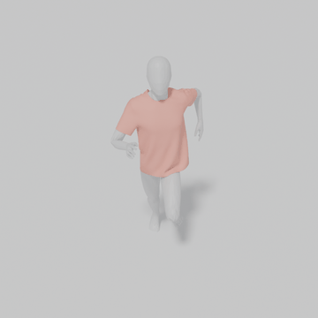
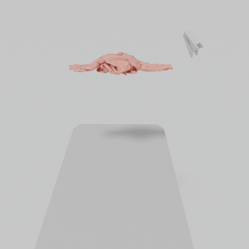

# Examples

Three test trajectories, one per scenario, are listed in [`showcase.txt`](showcase.txt).

<table>
  <tr>
    <td align="center"><b>Human Garment</b></td>
    <td align="center"><b>Robotic Manipulation</b></td>
    <td align="center"><b>Diverse Object Collision</b></td>
  </tr>
  <tr>
    <td align="center"><a href="media/human_garment.mp4"></a></td>
    <td align="center"><a href="media/robotic_manipulation.mp4"></a></td>
    <td align="center"><a href="media/object_collision.mp4"></a></td>
  </tr>
  <tr>
    <td align="center"><code>sims_garment_anim_all/</code><br><code>sim_00005</code></td>
    <td align="center"><code>sims_grasp_all_case1/</code><br><code>sim_00524</code></td>
    <td align="center"><code>sims_collision_all_static_1k/</code><br><code>sim_00524</code></td>
  </tr>
</table>

## Reproduce

```bash
# Download the three trajectories (~70 MB)
python scripts/download_data.py --file-list examples/showcase.txt

# Roll them out and export .obj sequences to outputs/rollouts/
python main.py infer.ckpt=checkpoints/ct-no-ccd-preview.pt infer.file_list=examples/showcase.txt \
    ccd_postprocess.enabled=true runtime.dtype=float16
```

The exported `pred/` or `pred_ccd_post/`, `gt/` and `collision/` folders hold frame-aligned `.obj`
sequences that can be imported into Blender or Houdini.

## CCD Post-Processing

Add `ccd_postprocess.enabled=true` to run continuous collision detection (CCD) on every predicted
frame and resolve the detected penetrations, for up to `max_iter` iterations. It covers contacts
between the cloth and the collider (`collider_vf`, `collider_tv`, `collider_ee`) and self contacts
of the cloth (`self_vf`, `self_ee`, off by default).

Per-trajectory overrides are read from
[`configs/ccd_config_per_scene.yaml`](../configs/ccd_config_per_scene.yaml), keyed by
`<category>/<sim_id>`; `enabled: false` turns the post-processing off for one trajectory (the
grasping example). Every other trajectory uses the defaults in `configs/default.yaml`. Each of the
three examples uses its own CCD parameters.
